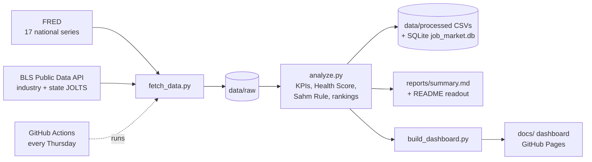

# US Job Market Pulse

**Is it getting easier or harder to find a job in America?**
An automated analytics pipeline and live dashboard that tracks the US labor market every week: job openings, layoffs, jobless claims, wages vs. inflation, and a single **Labor Market Health Score** - broken down by industry and state.

**Live dashboard:** https://rohitkanduri24-lgtm.github.io/us-job-market-pulse/

   

---

## Latest readout

<!-- INSIGHTS:START -->
_Auto-updated 2026-10-25 16:36 UTC_

- **Labor Market Health Score: 60/100 (Healthy)** as of August 2026, up 6 points from a year earlier.
- There are **1.01 job openings per unemployed person** (vs 0.94 a year ago). More openings than job seekers.
- Unemployment rate: **4.2%** in September 2026, -0.2 pts year over year.
- Quits rate: **1.9%** - a gauge of worker confidence (it peaked near 3.0% in the 2021-22 "Great Resignation").
- Real wage growth: **-0.7%** year over year - paychecks are falling behind inflation.
- Sahm Rule recession indicator: **0.23** - not triggered; threshold is 0.50.
- Hiring demand rose most in **Retail trade** (+0.9 pts openings rate) and fell most in **Leisure & hospitality** (-1.2 pts).
- Highest state layoff rates (December 2025): Idaho (10.9%), Indiana (1.7%), Alaska (1.5%).
<!-- INSIGHTS:END -->

## Why this project

Layoff headlines and "the job market is fine" headlines often appear the same week. This project cuts through that by combining the official indicators economists watch into one view that answers practical questions:

| Business question | Metric used |
|---|---|
| Are there enough jobs for the people looking? | **Job openings per unemployed person** (V/U ratio) |
| Are companies cutting staff? | **Layoffs & discharges rate** (JOLTS) and **weekly initial jobless claims** |
| Do workers feel confident? | **Quits rate** - people quit when they expect to find something better |
| Are paychecks keeping up with prices? | **Real wage growth** = wage growth adjusted for CPI inflation |
| Is a recession signal flashing? | **Sahm Rule indicator** (≥ 0.50 has accompanied every recession since 1970) |
| Overall, how healthy is the market vs. history? | **Labor Market Health Score** (0-100, see method below) |
| Which industries and states are hiring or firing? | Industry & state JOLTS rates and year-over-year change |

## How it works



1. **Extract** - `src/fetch_data.py` pulls national data from FRED's public CSV endpoint and industry/state detail from the BLS API, with retries and a log of any series that fail.
2. **Transform & analyze** - `src/analyze.py` reshapes the data, derives metrics (V/U ratio, real wages, 3-month payroll average, Sahm Rule), scores market health, ranks industries and states, and writes plain-English insights.
3. **Load** - processed tables go to CSV and a **SQLite database** (`data/job_market.db`) for SQL analysis (`sql/insights.sql`).
4. **Visualize** - `src/build_dashboard.py` exports `docs/data.js`; `docs/index.html` is a dependency-free interactive dashboard (hover tooltips, time-range filter, state tile map, light/dark mode).
5. **Automate** - `.github/workflows/refresh.yml` runs tests and the pipeline weekly, commits new data, and the dashboard republishes itself.

## Labor Market Health Score - method

For each of six indicators - openings per unemployed, hires rate, quits rate, layoffs rate, unemployment rate, and initial claims (monthly average) - the score finds where the current month ranks against every month since 2001 (its percentile). Percentiles are flipped for "lower is better" measures, then averaged and scaled to 0-100.

| Score | Label |
|---|---|
| 70+ | Hot |
| 55-70 | Healthy |
| 40-55 | Cooling |
| < 40 | Weak |

It is a transparent, descriptive index - not a forecast.

## Run it yourself

```bash
git clone https://github.com/rohitkanduri24-lgtm/us-job-market-pulse.git
cd us-job-market-pulse
python3 -m venv .venv && source .venv/bin/activate
pip install -r requirements.txt
python -m src.pipeline          # downloads data, analyzes, builds dashboard
open docs/index.html            # macOS (or double-click the file)
python -m pytest -q             # tests use synthetic data, no internet needed
sqlite3 data/job_market.db < sql/insights.sql
```

Optional: a free [BLS API key](https://data.bls.gov/registrationEngine/) (set `BLS_API_KEY`, or add it as a GitHub Actions secret) raises request limits and extends industry/state history from 10 to 20 years.

## Project structure

```
├── src/
│   ├── config.py            # series IDs, paths, score components
│   ├── fetch_data.py        # extract from FRED + BLS API
│   ├── analyze.py           # metrics, Health Score, insights, SQLite
│   ├── build_dashboard.py   # export for the web dashboard
│   └── pipeline.py          # end-to-end runner
├── sql/insights.sql         # example analyst queries
├── data/raw | processed     # versioned data snapshots (refreshed weekly)
├── docs/index.html          # interactive dashboard (GitHub Pages)
├── reports/summary.md       # auto-generated weekly readout
├── tests/                   # pytest suite on synthetic data
└── .github/workflows/       # weekly automated refresh
```

## Skills demonstrated

Data engineering (API extraction, retries, ETL, data versioning) · Time-series analysis (YoY change, rolling averages, percentile ranking) · KPI design and composite indexing · SQL (SQLite) · Data visualization and dashboard design · Automation & CI (GitHub Actions) · Testing (pytest) · Translating data into plain-English business insight.

## Data sources & limitations

- **FRED** (Federal Reserve Bank of St. Louis) for BLS JOLTS, Current Population Survey, Current Employment Statistics, CPI, NBER recession dates, and Department of Labor weekly claims.
- **BLS Public Data API** for JOLTS industry and state estimates.
- JOLTS is released with a ~5-week lag; claims are weekly; state JOLTS figures are model-based and get revised. All series are seasonally adjusted except the recession indicator.

## Author

**Rohit Kumar Kanduri** - Business Analysis Consultant · MS Business Analytics, University of North Texas
